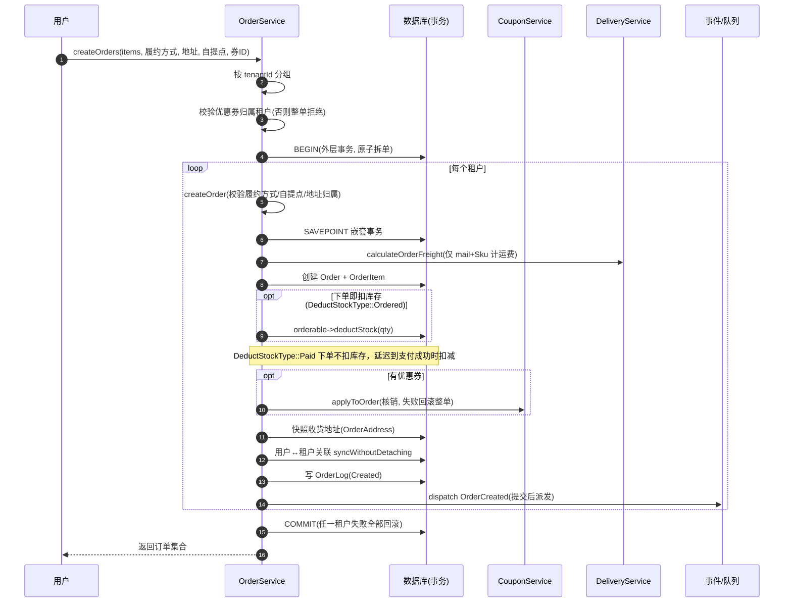
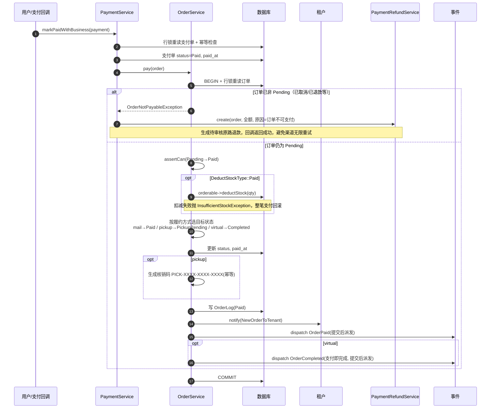
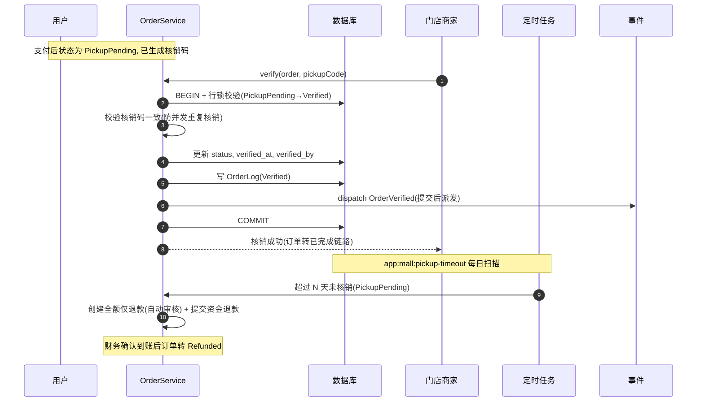
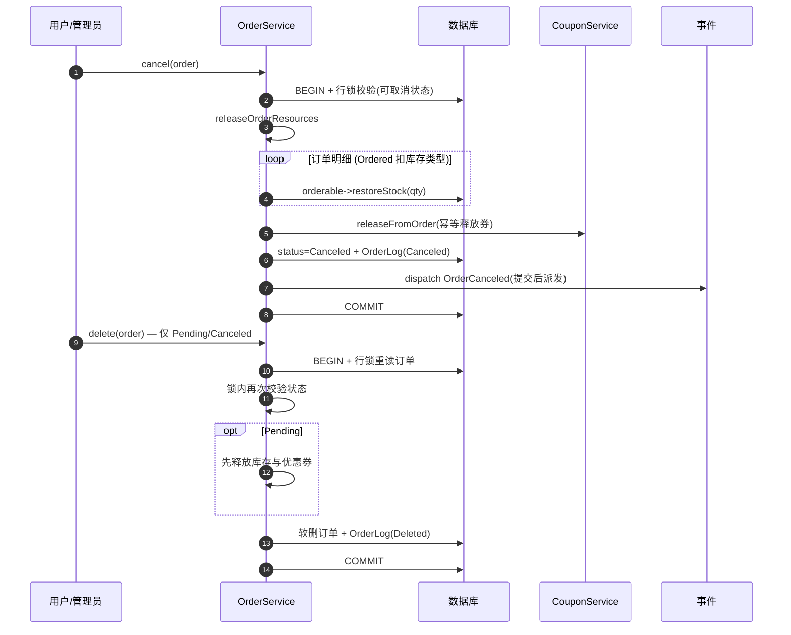
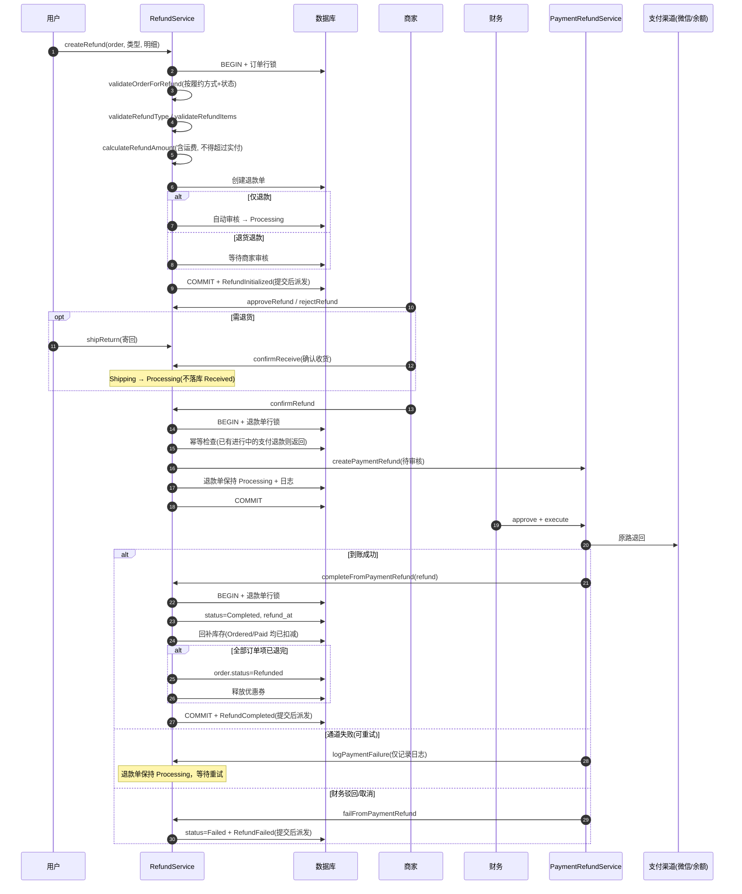

# 商城订单流程时序图

> 基于 `app/Services/Mall/OrderService.php`、`RefundService.php`、`app/Services/Finance/PaymentService.php`、
> `PaymentRefundService.php` 梳理，配合 [order-status.md](order-status.md)（状态机）阅读。
>
> 文中「提交后派发」指事件实现 `ShouldDispatchAfterCommit`：事务提交后才执行监听器；事务回滚则事件不会派发。

## 1. 下单（跨租户拆单）



## 2. 支付（按履约方式分流）



若付款时库存不足，`PaymentService` 会调用 `OrderService::cancel()` 关闭订单，再生成原路退款，避免「钱已收、货没有」。

## 3. 发货 → 签收 → 完成（快递邮寄）

```mermaid
sequenceDiagram
    autonumber
    participant M as 商家(backend面板)
    participant OS as OrderService
    participant DB as 数据库
    participant U as 用户
    participant EQ as 事件

    M->>OS: deliver(order, itemIds, 快递公司, 单号)
    OS->>DB: BEGIN + 行锁校验(Paid/Preparing/PartiallyShipped→Delivered)
    OS->>OS: 校验所选明细未发货且未全额退款
    OS->>DB: 创建 OrderShipping + 绑定收货地址
    OS->>DB: 明细关联 order_shipping_id
    OS->>OS: 全部发货? Delivered : PartiallyShipped
    OS->>DB: 写 OrderLog(Delivered)
    OS->>EQ: dispatch OrderDelivered / OrderPartiallyShipped(提交后派发)
    OS->>DB: COMMIT

    U->>OS: sign(order)
    OS->>DB: BEGIN + 行锁校验(→Signed)
    OS->>DB: 更新 status, signed_at; 发货记录补 sign_at
    OS->>DB: 写 OrderLog(Signed)
    OS->>EQ: dispatch OrderSigned(提交后派发)
    OS->>DB: COMMIT

    U->>OS: complete(order)
    OS->>DB: BEGIN + 行锁校验(→Completed)
    OS->>DB: 写 OrderLog(Completed)
    OS->>EQ: dispatch OrderCompleted(提交后派发)
    OS->>DB: COMMIT
```

> 发货为「整条订单明细」粒度：已发货明细不可重复发货，已全额退款明细不可再发货。
> 已支付订单全部退款后进入 `Refunded`，不再允许发货/签收。

## 4. 门店自提（pickup）



超时天数由 `custom.mall.pickup_expired_days` 控制（默认 7 天，`0` 关闭）。

## 5. 取消 / 删除（未支付释放资源）



> 取消/删除只回补「下单已扣减」的库存（`DeductStockType::Ordered`）。
> `DeductStockType::Paid` 的商品此时尚未扣库存，不会重复回补。

## 6. 退款（RefundService + PaymentRefundService）



**关键点：**

- 售后单 `Completed` 以「资金实际退回」为准，`confirmRefund` 只提交支付退款单，不再提前完成售后。
- 支付退款单完成（微信到账 / 余额退回）后，才回补库存、释放优惠券、写 `RefundCompleted`。
- 部分退款不改变订单状态；全部订单项退完才进入 `Refunded` 终态。
- `RefundStatus::Received` 仅保留枚举兼容，`confirmReceive()` 实际把状态从 `Shipping` 直接推进到 `Processing`。
- `RefundService` 的校验、状态判断与资源回收均在事务内加锁后执行；支付退款单的审核/执行使用条件更新抢占，避免并发重复打款。

## 关键机制说明

| 机制 | 实现 |
|---|---|
| 状态机 | `OrderStatus::canTransitionTo(target, fulfillment_type)`，按履约方式分流；退款完成写 `Refunded` 属旁路状态机（见 order-status.md） |
| 并发防护 | 多数状态流转：`assertCanWithLock`（`lockForUpdate` + 重读校验）；支付/删除订单/删物流按各自事务内行锁校验；退款：`RefundService::lockRefund`；支付单：`PaymentService::markPaidWithBusiness` 行锁 + 幂等；支付退款：条件更新抢占 |
| 拆单原子性 | 外层事务按租户循环建单，任一失败整体回滚（内层为嵌套 savepoint） |
| 库存 | `DeductStockType::Ordered` 下单扣减；`DeductStockType::Paid` 支付成功扣减；取消只回补下单扣减部分；退款完成按退款明细回补 |
| 优惠券 | 下单即核销，取消/删除/全部退款完成时幂等释放 |
| 事件驱动 | 事件实现 `ShouldDispatchAfterCommit`，事务提交后派发；`OrderCreated/Paid/Delivered/Signed/Verified/Completed/Canceled` 与 `RefundInitialized/Completed/Failed` |
| 结算 | `OrderCompleted` 事件已预留，`OrderCompletedListener` 当前为空实现，结算（`ShouldSettlement` / Voucher）尚未接入 |
| 审计 | 每步写 `OrderLog` / `RefundLog`（action + 操作人 + 前后状态 + 上下文） |
